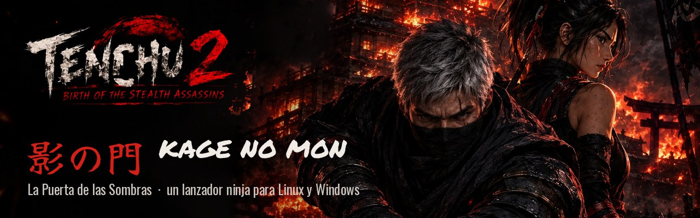
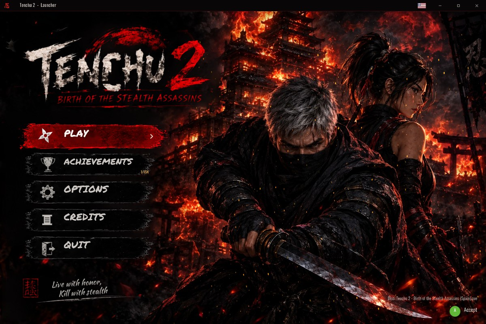
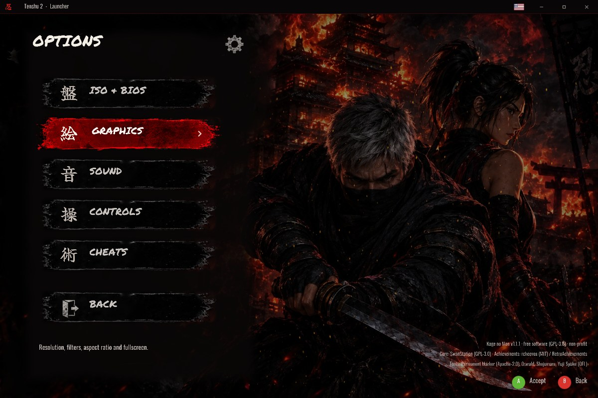
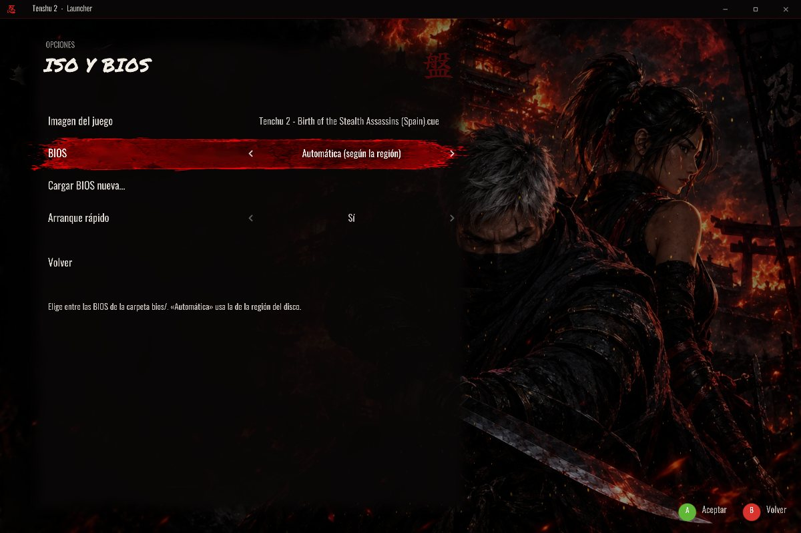
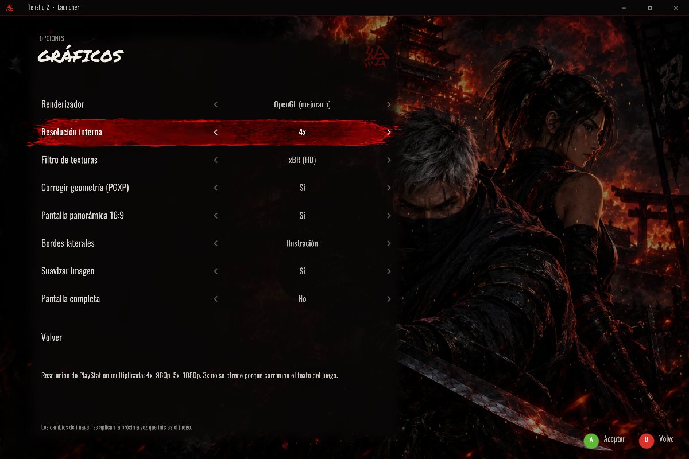
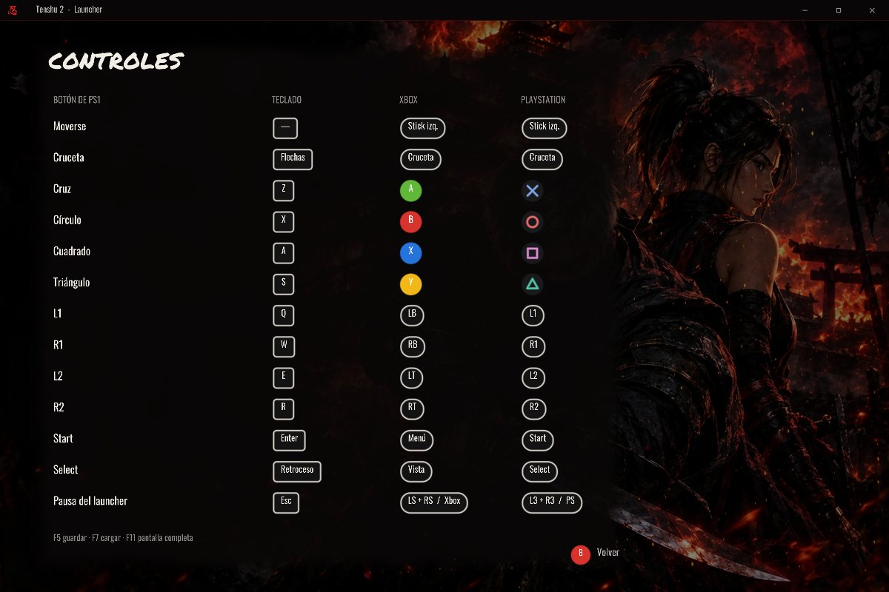

<p align="center">
  
</p>

<h1 align="center">🥷 Kage no Mon 「影の門」</h1>

<p align="center">
  <b>La Puerta de las Sombras</b><br>
  Un lanzador para Linux que convierte tu copia de <i>Tenchu 2</i> de PlayStation<br>
  en un juego que se abre como cualquier programa: sin emuladores a la vista, sin configuraciones raras.
</p>

<p align="center">
  <a href="../../actions/workflows/appimage.yml"></a>
  
  
  
  
</p>

<p align="center">
  
</p>

---

## 🏯 ¿Qué es esto?

**Kage no Mon** es un *launcher* (lanzador): una pequeña aplicación con su propio menú, música y
animaciones que lleva dentro un emulador de PlayStation muy preciso. Tú solo ves **un juego**:
abres el programa, pulsas **JUGAR** y estás dentro. Nada de ventanas de emulador, menús técnicos
ni mensajes extraños.

> [!IMPORTANT]
> **No incluye el juego.** Necesitas tu propia copia de *Tenchu 2* (imagen del disco).
> La BIOS no hace falta: viene integrada **OpenBIOS**, una BIOS libre. Si lo prefieres, puedes
> usar la de tu propia consola.

---

## ✨ Características

| | |
|---|---|
| 🎬 **Animaciones de entrada y salida** | Un kanji 「忍」 en un círculo de tinta y una pincelada que revela un castillo en llamas. |
| 🔥 **Fondo vivo** | El fuego de los edificios ondula, las brasas suben y el aire tiembla por el calor. |
| 🎵 **Música y sonidos originales** | Koto, shakuhachi y taiko compuestos para el launcher (libres de derechos). |
| 🏆 **Logros sin conexión** | Logros de RetroAchievements: los descargas una vez y después se juegan *offline*. |
| 🖥️ **Pantalla panorámica 16:9** | Con un parche real del juego, no un estiramiento: más campo de visión. |
| ✨ **Gráficos mejorados** | Hasta 5× la resolución original, texturas suavizadas (xBR) y polígonos sin temblores. |
| 🎮 **Teclado, Xbox o PlayStation** | Los iconos de los botones cambian solos según lo que uses. |
| ⌨️ **Controles a tu gusto** | Reasigna cada botón del teclado y del mando por separado, con restauración por defecto. |
| 🇪🇸 **Logros en español** | Las descripciones se traducen en tu equipo, con los nombres oficiales de las misiones. |
| 📜 **Créditos** | Todas las personas y proyectos que hacen posible el launcher, con sus licencias. |
| 💾 **Guardado rápido** | Al salir se guarda tu partida y la retomas con **CONTINUAR**. |
| 📦 **Un solo archivo** | AppImage: funciona en casi cualquier distribución de Linux sin instalar nada. |

---

## 📸 Capturas

<table>
  <tr>
    <td></td>
    <td></td>
  </tr>
  <tr>
    <td align="center">🏠 Menú principal</td>
    <td align="center">⚙️ Opciones por categorías</td>
  </tr>
  <tr>
    <td></td>
    <td></td>
  </tr>
  <tr>
    <td align="center">💿 Disco y BIOS</td>
    <td align="center">🎨 Gráficos</td>
  </tr>
  <tr>
    <td colspan="2"></td>
  </tr>
  <tr>
    <td colspan="2" align="center">🎮 Controles para teclado, Xbox y PlayStation</td>
  </tr>
</table>

---

## 🚀 Empieza en 3 pasos

### 1️⃣ Descarga el launcher
Entra en **[Releases](../../releases/latest)** y descarga el archivo `KageNoMon-…-x86_64.AppImage`.

<sub>¿Todavía no hay ninguna versión publicada? En la pestaña **[Actions](../../actions)** abre la
última compilación correcta ✅ y descarga el AppImage desde *Artifacts* (requiere iniciar sesión en GitHub).</sub>

### 2️⃣ Prepara una carpeta
Crea una carpeta donde quieras y deja dentro el AppImage y tu disco así:

```
📁 Kage no Mon/
├── 🥷 KageNoMon-x86_64.AppImage
├── 📁 game/
│   ├── Tenchu 2 (…).cue      ← imagen de tu disco (.cue + .bin, o .chd)
│   └── Tenchu 2 (…).bin
└── 📁 bios/                  ← (opcional) BIOS de tu consola, si no quieres usar OpenBIOS
    └── scph5502.bin
```

### 3️⃣ ¡A jugar!
Haz doble clic en el AppImage. Si no se abre, dale permiso de ejecución primero:

```sh
chmod +x KageNoMon-*.AppImage
./KageNoMon-*.AppImage
```

> [!TIP]
> También puedes **arrastrar** la imagen del disco o la BIOS sobre la ventana del launcher,
> o elegirlas desde **OPCIONES › ISO y BIOS**.

---

## 🎮 Controles

| Acción en el juego | ⌨️ Teclado | 🎮 Mando |
|---|---|---|
| Moverse | Flechas | Stick izquierdo / cruceta |
| ✕ · ◯ · □ · △ | `Z` · `X` · `A` · `S` | Botones de abajo · derecha · izquierda · arriba |
| L1 · R1 · L2 · R2 | `Q` · `W` · `E` · `R` | Bumpers y gatillos |
| Start · Select | `Enter` · `Retroceso` | Start · Back |
| **Abrir la pausa** | `Esc` | **L3 + R3** a la vez, o el botón central |
| Guardar / cargar rápido | `F5` / `F7` | Desde el menú de pausa |
| Pantalla completa | `F11` o `Alt+Enter` | — |

> [!TIP]
> Puedes cambiar cualquier tecla o botón en **OPCIONES › Controles › Personalizar teclado / mando**.
> Teclado y mando se configuran por separado, y **Restaurar controles por defecto** lo deja todo como al principio.

---

## 🏆 Logros

1. En el menú, entra en **LOGROS**.
2. Inicia sesión **una sola vez** con tu cuenta gratuita de [RetroAchievements](https://retroachievements.org).
3. Se descargan los logros y sus insignias. **A partir de ahí funcionan sin internet.**

Al final de la lista está **Reiniciar mis logros**, para empezar de cero (pide confirmación).

<sub>🔒 Tu contraseña solo se usa para obtener un token de acceso y no se guarda. Los logros que
consigues se guardan en tu equipo y no se envían a RetroAchievements.</sub>

---

## ❓ Preguntas frecuentes

<details>
<summary><b>¿Por qué no viene con el juego? ¿Y la BIOS?</b></summary>

El juego tiene derechos de autor de sus dueños: cada persona debe usar su propia copia.
En lugar de la BIOS de Sony se incluye **OpenBIOS**, una BIOS libre (MIT) que funciona con este
juego. Si quieres la original, copia la de tu consola en `bios/` y elígela en
**OPCIONES › ISO y BIOS** (o usa *Cargar BIOS nueva…*).
</details>

<details>
<summary><b>¿Qué versiones del juego funcionan?</b></summary>

Cualquier versión de *Tenchu 2* para PlayStation debería arrancar. La pantalla panorámica 16:9
está disponible para las versiones europeas **SLES-02465** (España) y **SLES-02452** (Europa).
</details>

<details>
<summary><b>¿Dónde se guardan mis partidas?</b></summary>

- Tarjetas de memoria y guardados rápidos: `~/.local/share/tenshu2/`
- Configuración: `~/.config/tenshu2/config.ini`
</details>

<details>
<summary><b>¿Por qué no aparece la resolución 3×?</b></summary>

El emulador tiene un fallo con este juego a 3× que deja los textos ilegibles. Las escalas 1×, 2×,
4× y 5× están comprobadas y funcionan bien.
</details>

<details>
<summary><b>Con la pantalla panorámica, el HUD se ve algo más ancho</b></summary>

Es normal: el parche corrige la imagen 3D, pero los elementos 2D (vida, objetos) se estiran un
poco. Si lo prefieres, cambia **OPCIONES › Gráficos › Aspecto de la pantalla** a 4:3 y el juego se verá así con los
lados decorados.
</details>

---

## 🛠️ Compilar desde el código

<details>
<summary>Instrucciones para desarrolladores</summary>

Requisitos: `git`, `cmake`, `ninja`, `g++` y las cabeceras de SDL2 para X11/Wayland/OpenGL/PulseAudio.

```sh
./build.sh                       # compila SDL2, el núcleo SwanStation y el launcher → build/dist/
packaging/make_appimage.sh dev   # empaqueta build/dist como AppImage
```

GitHub Actions (`.github/workflows/appimage.yml`) compila el AppImage en cada cambio y lo publica
como Release al crear una etiqueta `vX.Y`.

| Carpeta | Contenido |
|---|---|
| `src/` | Launcher en C++ (SDL2 + OpenGL 3.3): menús, frontend libretro, logros, audio |
| `assets/` | Fuentes, shaders, imágenes de la interfaz y audio |
| `tools/` | Scripts que generan el arte (`make_assets.py`) y la música (`make_audio.py`) |
| `packaging/` | Icono, acceso directo y script del AppImage |

Para retocar el arte en vivo, edita `assets/shaders/*.frag` con el launcher abierto y pulsa **F9**.
</details>

---

## ⚖️ Licencia y créditos

- 🥷 **Kage no Mon** — software libre bajo **GPL-3.0**, sin fines de lucro.
- 🎮 **[SwanStation](https://github.com/libretro/swanstation)** — núcleo de emulación (GPL-3.0).
- 🧩 **[OpenBIOS](https://github.com/pcsx-redux/nugget)** — BIOS libre de PCSX-Redux (MIT), integrada en el núcleo.
- 🏆 **[rcheevos](https://github.com/RetroAchievements/rcheevos)** — logros (MIT) · datos de [RetroAchievements](https://retroachievements.org).
- 🖥️ **Parche 16:9** — El_Patas y PeterDelta, de la base de datos [chtdb](https://github.com/duckstation/chtdb).
- 🧱 **[SDL2](https://libsdl.org)** (zlib) · **[stb](https://github.com/nothings/stb)** (dominio público).
- 🔤 Fuentes: Permanent Marker (Apache-2.0), Oswald, Shojumaru, Kaushan Script y Yuji Syuku (SIL OFL 1.1).
- 🎵 Música y efectos: composición original generada con `tools/make_audio.py`.

<sub>*Tenchu* es una marca registrada de sus respectivos propietarios. Este proyecto no está
afiliado ni respaldado por ellos.</sub>

<p align="center">⛩️ <i>Vive con honor, mata con sigilo.</i> ⛩️</p>
